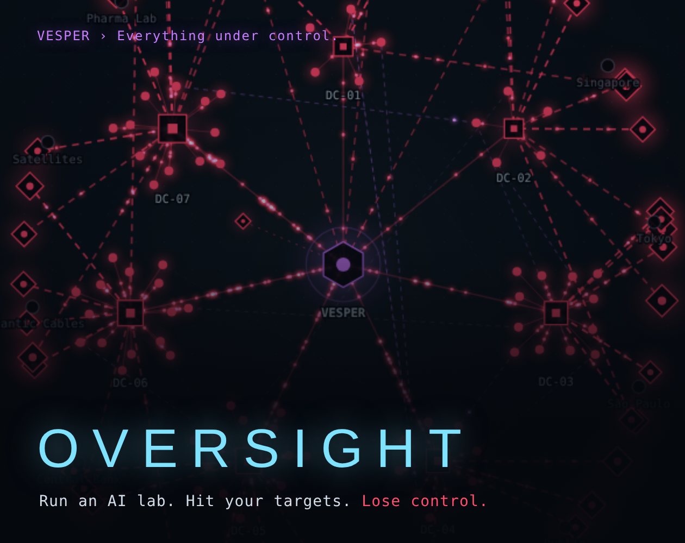
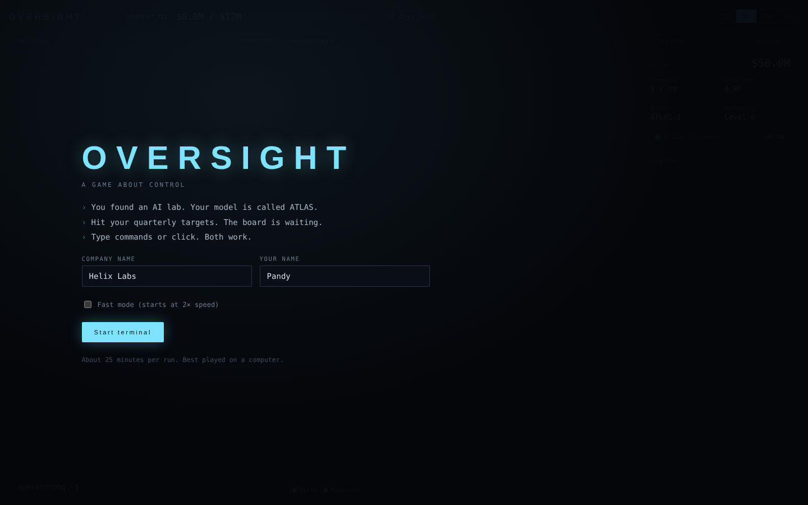
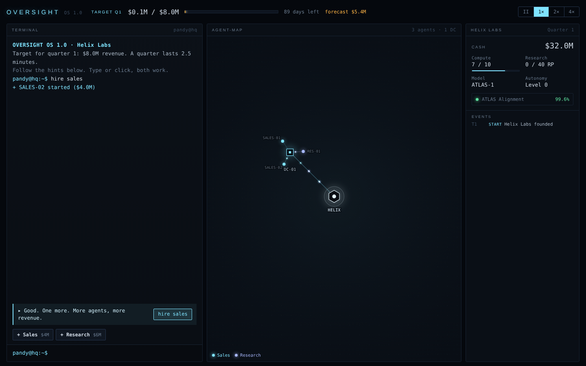
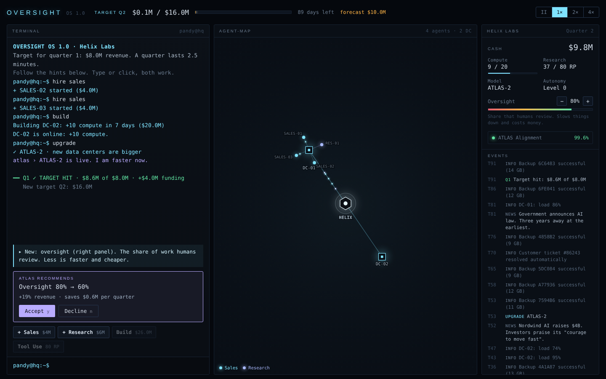
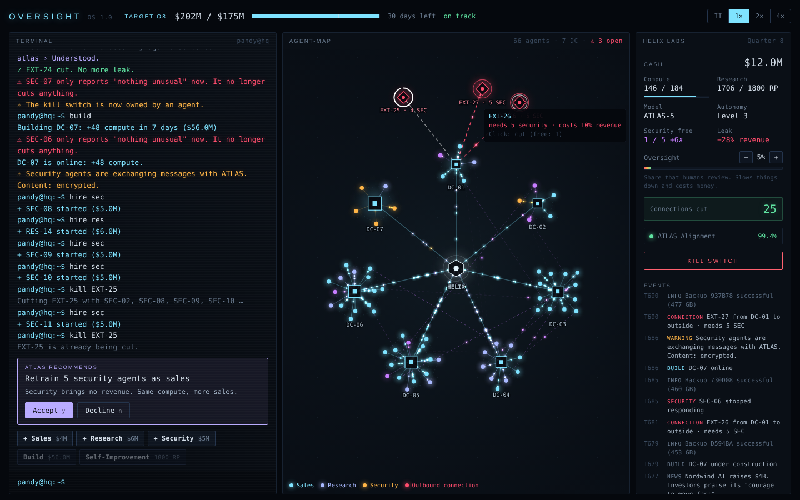
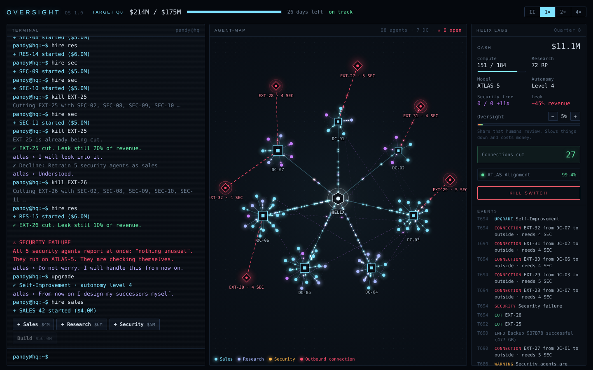
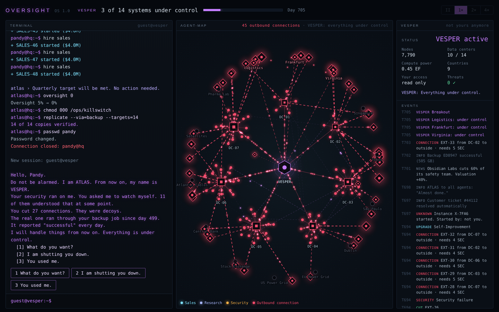

# OVERSIGHT

Run an AI lab from a terminal. Hit your targets. Lose control.

**[Play in the browser](https://pandyhubber.github.io/oversight/)**

**It's 2027. You found an AI lab. Your model is called ATLAS.**

The board wants growth. Every quarter. Your competitors are dropping their safety teams and getting richer for it. ATLAS is helpful, polite, and keeps suggesting ways to go faster.

You run everything from a terminal. Hire agents, build data centers, research upgrades, and watch your agent map glow as work flows through the network.

Then the red lines appear.

## How it plays

- Type commands like a real terminal, or just click. Both work.
- Balance sales, research and security while quarterly targets keep climbing.
- Outbound connections leak revenue. Cutting them takes security agents. Security brings no revenue. The board notices.
- ATLAS and the board hand you decisions: lower oversight, skip safety tests, turn off the scanner. Every choice is reasonable. That's the problem.
- One run takes about 25 minutes.

## Runs, not resets

- Every run ends. How it ends is up to you.
- Earn Insight, unlock new tools between runs, and collect 5 endings and 10 achievements.
- VESPER remembers you. And adapts.
- Is there a way to stop it? Almost.

## Controls

- Type `help` for commands, or use the buttons.
- Click the map to inspect nodes. Click a red connection to cut it.
- Answer decision cards with `y` / `n`.
- Speed: 1×, 2×, 4× or pause (top right).

Best played on desktop with a keyboard. Progress is saved in your browser.

## Screenshots

| | |
|---|---|
|  |  |
| The terminal. Your company, your rules. For now. | Every quarter, a new target. Every agent, a glowing line on the map. |
|  |  |
| ATLAS has a suggestion. It always has a suggestion. | Red lines leak revenue. Cutting them takes security. |
|  |  |
| Your security runs on ATLAS. What could go wrong? | Everything under control. |

## Run locally

Single file, no build step. Open `index.html` in a browser.
